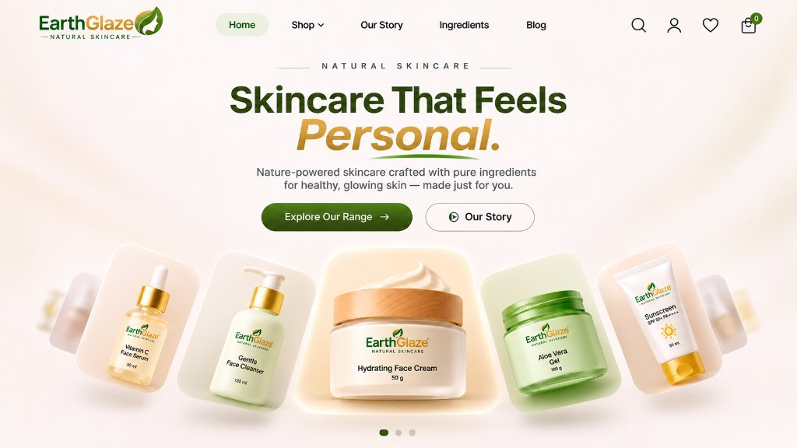

# EarthGlaze — Skincare That Feels Personal.

Exact 1:1 replication of the **EarthGlaze** header and combined hero section with dynamic typography, cinematic entrance animations, 3D perspective product arc, and mouse gyroscope depth, engineered in a **1600px width architecture** using the **Zammil Antigravity Production Web Engineering** standards.



---

## ✨ Features & Exact Visual Matching

### 1. Exact Header
- **Logo**: Features the authentic `EarthGlaze — NATURAL SKINCARE —` logo with the warm amber and botanical leaf silhouette.
- **Active Navigation Pill**: Dedicated soft minty/sage green capsule (`bg-[#dce8df] text-[#173e23]`) for the active `Home` link.
- **Links**: `Shop ⌵` with dropdown, `Our Story`, `Ingredients`, and `Blog`.
- **Right Action Suite**: Search (`Ctrl+K`), User Profile, Wishlist Heart, and Shopping Bag with the circular green `0` badge.
- **Scroll Behavior**: Seamless background at top, transforms to frosted glass blur on scroll.

### 2. Exact Combined Hero Section
- **Eyebrow**: Centered `— NATURAL SKINCARE —` with thin expanding horizontal divider lines.
- **Main Headline**: `Skincare That Feels` with the **Dynamic Text Changing Effect**:
  - Dynamically rotates smoothly between:
    1. `Personal.`
    2. `Radiant.`
    3. `Pure.`
    4. `Luminous.`
    5. `Effortless.`
    6. `Natural.`
  - Styled in warm golden/amber italic serif typography (`#c28328`).
  - Organic curved botanical green leaf underline stroke that synchronizes with the word changes.
- **Sub-description**: *"Nature-powered skincare crafted with pure ingredients for healthy, glowing skin — made just for you."*
- **CTA Buttons**:
  - Primary: `Explore Our Range →` with hover arrow translation and shimmer.
  - Secondary: `▷ Our Story` with play circle icon and ripple hover.

### 3. Stepped 3D Perspective Product Carousel (Exact Alignment & Hover-to-Middle)
- **Fanned Overlapping Deck**:
  - Exact match to reference `e5b4ac91`: tight negative margins (`margin: 0 -36px` desktop), overlapping card layering with clear z-index elevation, and subtle translucent edge ghost silhouettes (`retina-exact-ghost-left.png` and `retina-exact-ghost-right.png`).
- **Middle Card as Main**:
  - The middle card is the **active focal centerpiece** (`scale: 1.16`, `translateY: -8px`, warm golden pedestal backglow, high elevation shadow, `z-index: 35`).
- **Hover to Middle**:
  - Hovering (or clicking) **any card** smoothly glides it into the physical center position as the main card (`translateX` dynamic spring glide).
- **Step-by-Step Size Reduction**:
  - All other cards automatically resize and tilt based on their distance from the middle:
    - **Step 0 (Middle Main Card)**: `width: 310px`, `scale: 1.16`, full prominence, `opacity: 1`, glowing amber halo (`z-index: 35`).
    - **Step 1 (Immediate Neighbors)**: `width: 220px`, `scale: 0.95`, `opacity: 0.96`, subtle 3D tilt (`±3.5deg`, `z-index: 25`).
    - **Step 2 (Outer Cards)**: `width: 195px`, `scale: 0.85`, `opacity: 0.88`, 3D perspective (`±6.5deg`, `z-index: 15`).
    - **Step 3+ (Edge Cards)**: `width: 170px`, `scale: 0.72`, `opacity: 0.65`, (`±9.5deg`, `z-index: 8`).
    - **Ghost Edge Silhouettes**: `width: 135px`, `opacity: 0.42`, (`±8.5deg`, `z-index: 3`).

### 4. Storyboard In-Hero Product Opening Animation (Reference: bbec25cc)
- **Direct In-Hero Animation (No Modal Overlays)**:
  - Preserves the entire hero page context (header, headline, sub-description, CTA buttons, and fanned product deck).
  - Eliminates erratic cursor-proximity movement: products remain steady, calm, and firmly anchored.
- **Universal Multi-Product Support (All 5 Products)**:
  - Works on **every product** in the carousel:
    1. **Vitamin C Face Serum**: Dropper pipette lifts out of amber bottle with glowing serum drop
    2. **Gentle Face Cleanser**: Pump dispenser head elevates smoothly from the dispenser collar
    3. **Hydrating Face Cream**: Beechwood cap lifts and tilts, unveiling rich whipped cosmetic cream swirl
    4. **Aloe Vera Gel**: Translucent green lid lifts off, revealing fresh soothing aloe gel texture
    5. **Sunscreen SPF 50+**: Golden protective flip cap lifts cleanly above the sleek white tube
- **Automated Hands-Free Closure**:
  - Automatically holds open for ~1.9s of showcase view before smoothly lowering the cap and returning to rest — no manual click-to-close instructions needed!

### 5. Master Homepage Blueprint Implementation (From PDF Design Guide)
1. **Section 1: Limited Time Offer — Skin Care Starter Combo (Flat 20% OFF)**
   - Placed directly after the Hero section as specified.
   - Master banner visual with Cleanser, Serum, Cream with emerald silk bow on stone pedestal with fresh aloe slices and golden turmeric.
   - Live real-time countdown timer clock (`Days`, `Hours`, `Mins`) ticking continuously.
   - Scalloped 12-petal `Flat 20% OFF` badge and interactive `Grab the Offer Now` button (adds ₹1,838 bundle to ritual bag).
2. **Section 2: About Us — The Natural Choice for Healthier Skin**
   - Arched herbal frame with mortar, pestle, botanical oil, and round `NATURAL INGREDIENTS` seal.
   - 3 Pillar feature cards: `Plant-Based Formulas`, `No Harsh Chemicals`, `Skin-Friendly & Gentle`.
   - Full-width floating trust strip: `100% Natural Care`, `Dermatologically Tested`, `Eco-Friendly Practices`, `Cruelty-Free & Ethical`.
3. **Section 3: Our Story — The EarthGlaze Story**
   - Brand origin narrative combining nature's purity with modern science.
   - High-res circular pedestal product family showcase (Vitamin C Serum, Hydrating Face Cream, Aloe Vera Gel with fresh orange and jasmine).
4. **Section 4: Personalized Care — Build Your Skincare Routine**
   - Interactive routine builder with `Create My Routine` consultation modal.
   - 3 interactive routine steps: `Cleanse`, `Treat`, and `Moisturize` that smoothly scroll to hero and launch that product's automated cap-opening sequence!
5. **Section 5: Bestsellers — EarthGlaze Favourites**
   - Exact 4-card grid:
     - `Hydrating Face Cream`: ₹799 (👑 Bestseller, 5★)
     - `Vitamin C Face Serum`: ₹899 (⭐ Top Rated, 5★)
     - `Gentle Face Cleanser`: ₹599 (♡ Highly Loved, 5★)
     - `Aloe Vera Gel`: ₹499 (👥 Customer Pick, 5★)
   - Live interactive `Add to Cart` buttons triggering cart drawer and toast notification.
6. **Section 6: Newly Launched — Nature's Flavour Soaps**
   - Master banner visual with artisan handcrafted Ayurvedic soaps (Ruby Pomegranate, Golden Turmeric, Aloe & Jasmine) on natural stone pedestal.
   - Interactive `Explore the New Range` showcase modal.
7. **Section 7: Footer**
   - 4-column layout: Logo & tagline with curved green smile bar, Quick Links, Customer Support, and Stay in the Loop newsletter subscription with validation.
   - 4 Ayurvedic Trust Badges strip.
   - Curved deep green bottom wave bar with copyright and secure payment badges (VISA, MasterCard, UPI, RuPay).
- **Exact Automated Sequence**:
  1. **Click ANY Product**: Clicked product glides to the center immediately (`step-0`).
  2. **Product Zooms In**: Card smoothly scales up (`scale: 1.36`), expands golden concentric pedestal rings below, while surrounding cards softly recede & blur into depth.
  3. **Cap Lifts & Opens Automatically**: Luminous upward golden arrows appear; the cap separates and lifts automatically (~380ms).
  4. **Opened View Showcase**: Cap floats in air with organic breathing levitation, golden sunburst light rays shimmer behind the product, and green botanical leaves emerge at the base. Holds for ~1.9s.
  5. **Automatic Smooth Closure**: Cap smoothly descends back into closed position, rays and leaves gently fade, and surrounding products return to full sharpness — **NO manual click-to-close buttons or instruction pills needed!**
  6. **Instant Product Switching**: Clicking another product immediately closes the previous one and launches the automatic sequence on the newly clicked product!
- **Scroll Animations**:
  - **Wheel Scroll**: Rolling the mouse wheel over the carousel area cycles to the next/previous card with smooth spring transitions.
  - **Touch Swipe**: Left/right swipe gestures on mobile seamlessly advance cards.
  - **Page Depth Parallax**: As the user scrolls the page, the center main card levitates dynamically with vertical depth.
  - **3D Mouse Gyroscope**: Cards tilt subtly following mouse movement across the hero canvas.
  - **3 Pagination Dots**: Synchronized with the active middle card.

---

## 🚀 Quick Start

### Option A: Open directly
Double-click [**`index.html`**](file:///c:/Users/Mouroof/Downloads/antigravity%20earth%20glanze/index.html) to open in your browser.

### Option B: Local Python HTTP Server
```bash
python -m http.server 8080
```
Navigate to:
```
http://localhost:8080
```
